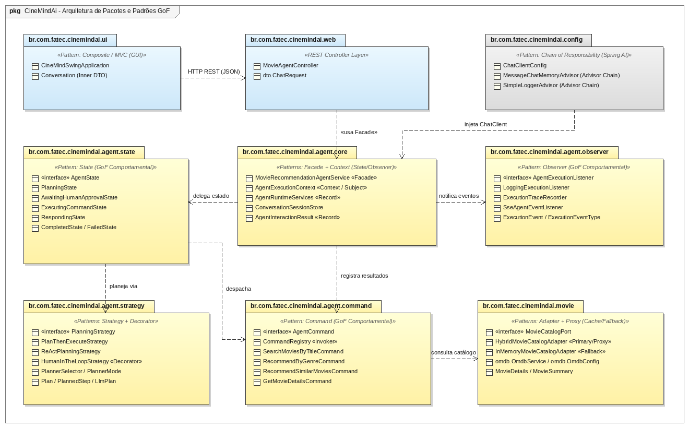
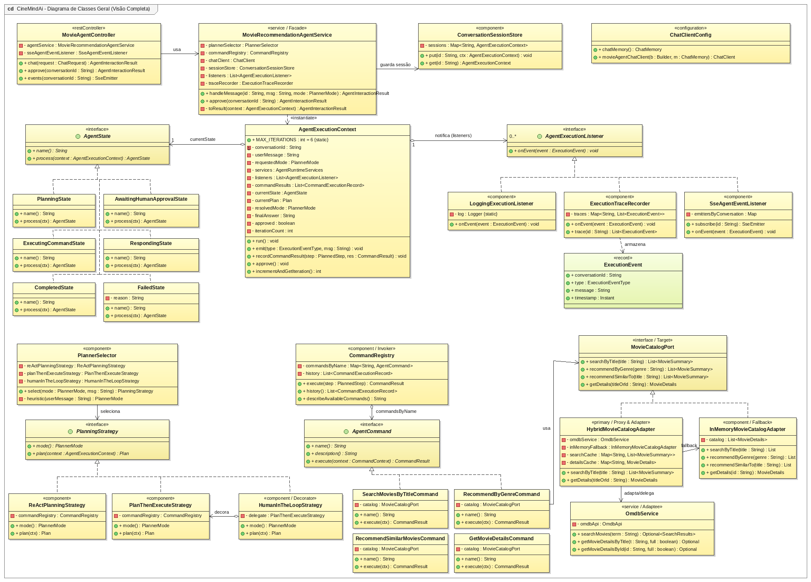
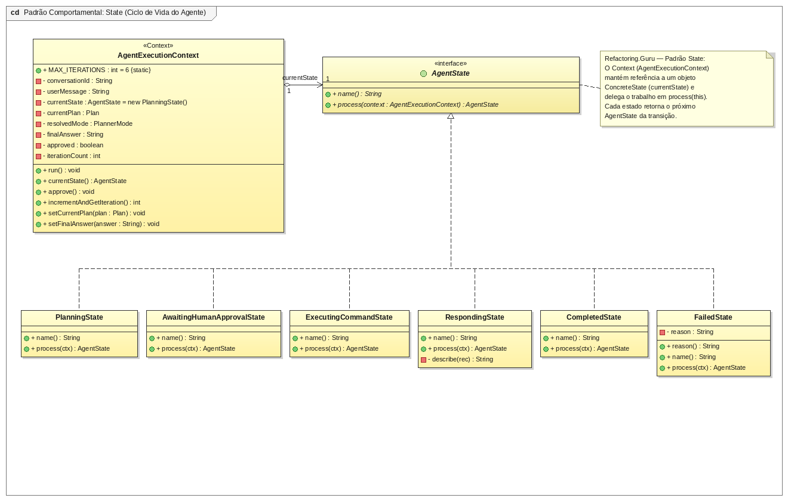
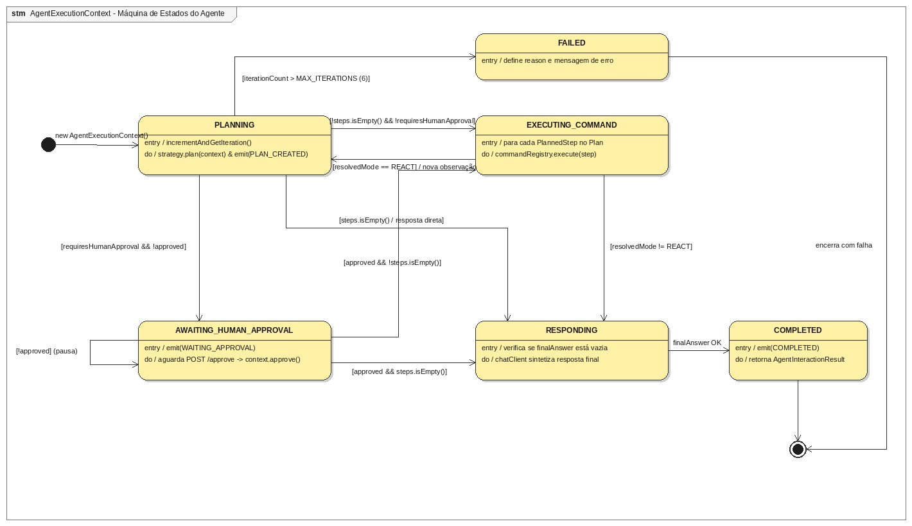
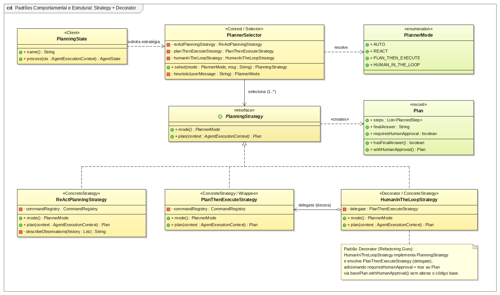
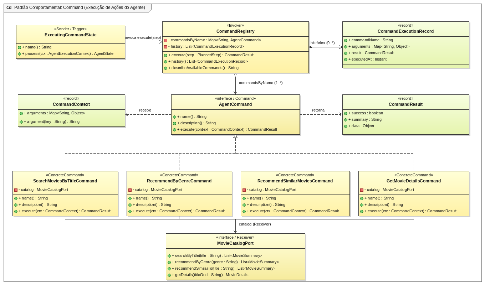
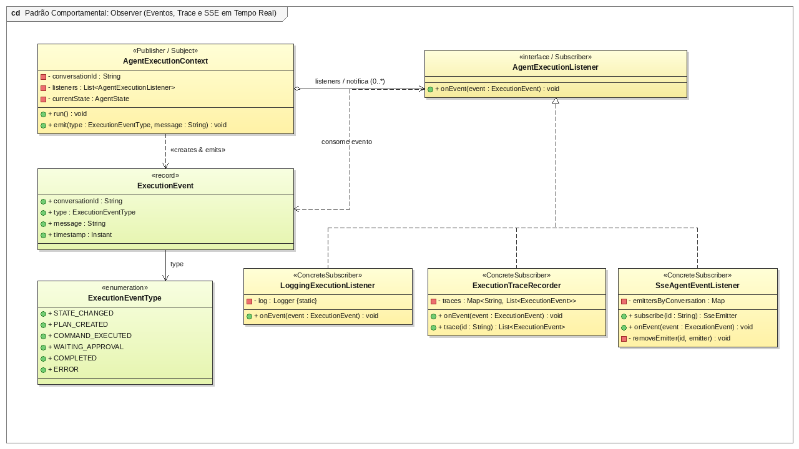
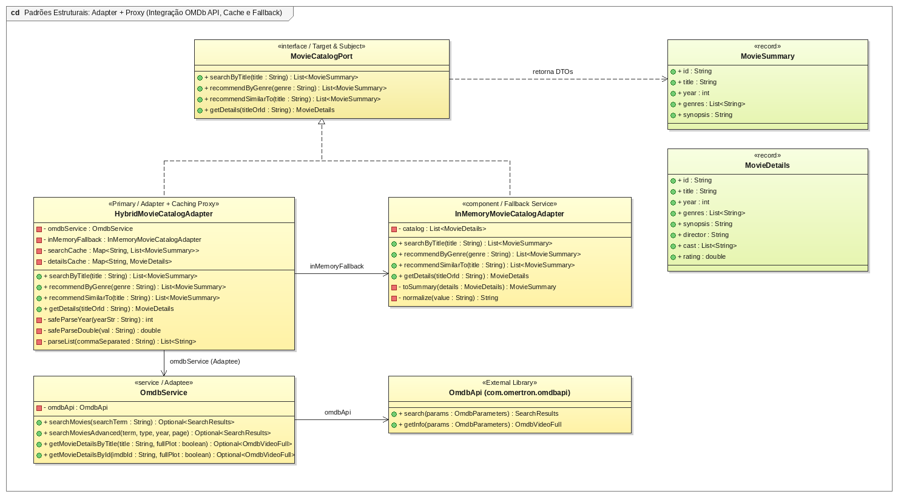
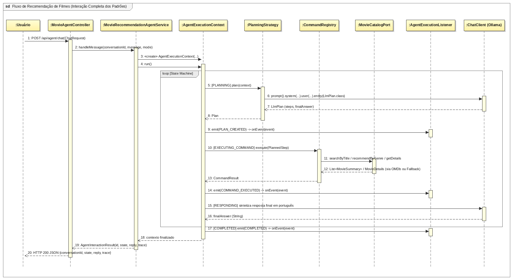
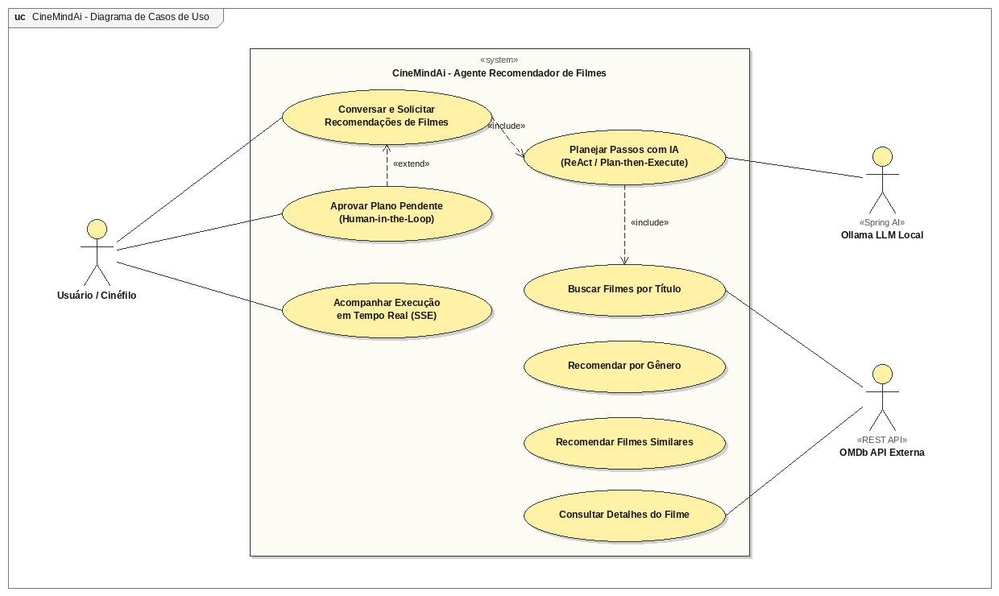

# 🎨 Padrões de Projeto no CineMindAi (Guia Arquitetural & Refactoring.Guru)

Este documento detalha como os **Padrões de Projeto (Design Patterns)** do catálogo clássico GoF ([**Refactoring.Guru — Design Patterns**](https://refactoring.guru/design-patterns)) foram modelados, implementados e integrados no projeto **CineMindAi**. 

Cada padrão conta com sua **motivação**, **mapeamento com os papéis do Refactoring.Guru**, **trechos de código reais do projeto**, **benefícios obtidos** e o respectivo **diagrama UML gerado no padrão clássico do Astah UML / Astah Professional** (caixas em gradiente creme-amarelo `#FFF2A6`, ícones de visibilidade UML, estereótipos `«interface»` / `«record»` e frames UML 2.x).

---

## 🗺️ Visão Geral da Arquitetura

O **CineMindAi** é um agente inteligente de recomendação de filmes desenvolvido com **Spring AI** e **Ollama** (LLM local). O sistema orquestra modelos de IA, ferramentas de consulta ao catálogo de filmes e clientes em tempo real através da composição harmoniosa de múltiplos padrões de design.



### Diagrama de Classes Geral (Visão Completa do Sistema)

Abaixo está a visão estrutural unificada de todo o sistema:



---

## 1. Padrão State (Comportamental)

- **Referência:** [Refactoring.Guru — State Pattern](https://refactoring.guru/design-patterns/state)
- **Pacotes:** `br.com.fatec.cinemindai.agent.state` e `br.com.fatec.cinemindai.agent.core`

### 🎯 Intenção e Problema Resolvido no CineMindAi
Um agente autônomo passa por etapas bem definidas: receber a mensagem, planejar ações com a IA, solicitar confirmação humana caso necessário, invocar ferramentas/comandos, sintetizar a resposta final ou tratar falhas.
Se esse ciclo fosse controlado por variáveis booleanas e condicionais (`if/switch`) dentro de uma classe monolítica, o código se tornaria frágil, propenso a estados inválidos (ex.: executar uma ação antes de criar um plano) e difícil de testar.

O padrão **State** transforma cada fase do ciclo de vida em uma classe concreta que implementa a interface comum `AgentState`. O objeto `AgentExecutionContext` atua como o **Context**, mantendo uma referência para o estado atual (`currentState`) e delegando a ele a transição de ciclo em `currentState.process(this)`.

### 👥 Mapeamento de Papéis (Refactoring.Guru ➔ CineMindAi)
- **Context:** `AgentExecutionContext` — Armazena os dados da conversa, plano atual, observações e executa o loop `run()`.
- **State (Interface):** `AgentState` — Define os métodos `name()` e `process(AgentExecutionContext context) : AgentState`.
- **Concrete States:**
  1. `PlanningState`: Invoca a estratégia de planejamento do LLM e decide o próximo estado (`ExecutingCommandState`, `AwaitingHumanApprovalState`, `RespondingState` ou `FailedState`).
  2. `AwaitingHumanApprovalState`: Pausa o ciclo de execução quando o plano requer intervenção humana (modo *Human-in-the-Loop*). Permanece em si mesmo até a chegada do `approve()`.
  3. `ExecutingCommandState`: Itera sobre os passos planejados (`PlannedStep`), despacha cada um no `CommandRegistry` e avança para `RespondingState` (ou volta para `PlanningState` se o modo for `REACT`).
  4. `RespondingState`: Envia os resultados das buscas ao LLM para sintetizar um texto natural em português e transiciona para `CompletedState`.
  5. `CompletedState`: Estado terminal bem-sucedido que finaliza o loop de execução.
  6. `FailedState`: Estado terminal acionado caso o limite máximo de iterações (`MAX_ITERATIONS = 6`) seja excedido.

### 💻 Implementação no Código
```java
// AgentState.java
public interface AgentState {
    String name();
    AgentState process(AgentExecutionContext context);
}

// AgentExecutionContext.java (Context)
public void run() {
    while (true) {
        AgentState previous = currentState;
        AgentState next = previous.process(this);
        boolean changed = next != previous;
        currentState = next;
        if (changed) {
            emit(ExecutionEventType.STATE_CHANGED, previous.name() + " -> " + next.name());
        }
        if (currentState instanceof CompletedState || currentState instanceof FailedState) {
            emit(ExecutionEventType.COMPLETED, "Execução finalizada em " + currentState.name());
            return;
        }
        if (currentState instanceof AwaitingHumanApprovalState && !changed) {
            emit(ExecutionEventType.WAITING_APPROVAL, "Aguardando aprovação humana para prosseguir");
            return;
        }
    }
}
```

### 📊 Diagramas UML do Padrão State

#### Diagrama de Classes — Padrão State


#### Diagrama de Máquina de Estados — Ciclo de Vida do Agente


---

## 2. Padrão Strategy (Comportamental) & Decorator (Estrutural)

- **Referências:** [Refactoring.Guru — Strategy](https://refactoring.guru/design-patterns/strategy) | [Refactoring.Guru — Decorator](https://refactoring.guru/design-patterns/decorator)
- **Pacote:** `br.com.fatec.cinemindai.agent.strategy`

### 🎯 Intenção e Problema Resolvido no CineMindAi
Diferentes pedidos exigem diferentes formas de raciocínio da IA:
- Um pedido direto ("*recomende filmes de comédia*") pode ser resolvido com uma única chamada em lote (*Plan-then-Execute*).
- Um pedido investigativo longo ("*procure um filme dos anos 80 com um cientista e um carro voador, e depois me dê filmes parecidos*") se beneficia do ciclo incremental ReAct (*Reason + Act*), onde a IA executa um passo, avalia o retorno e planeja o próximo.
- Um pedido que necessita de cautela ("*confirme comigo antes de buscar*") requer aprovação humana antes de disparar ferramentas.

O padrão **Strategy** define a interface `PlanningStrategy` com algoritmos de planejamento intercambiáveis. O `PlannerSelector` analisa o pedido do usuário e seleciona em tempo de execução a estratégia adequada.

Em conjunto, a classe `HumanInTheLoopStrategy` aplica o padrão **Decorator**: ela implementa `PlanningStrategy` e encapsula internamente uma instância de `PlanThenExecuteStrategy` (`delegate`). Ela delega a criação do plano ao componente base e **adiciona dinamicamente** o comportamento de exigir aprovação humana (`basePlan.withHumanApproval()`), sem alterar uma linha sequer de `PlanThenExecuteStrategy`.

### 👥 Mapeamento de Papéis (Refactoring.Guru ➔ CineMindAi)
- **Strategy (Interface):** `PlanningStrategy` — Método `plan(AgentExecutionContext context) : Plan`.
- **Concrete Strategies:**
  - `PlanThenExecuteStrategy`: Gera um plano com todos os comandos de uma só vez via chamada estruturada ao `ChatClient`.
  - `ReActPlanningStrategy`: Gera 1 comando por vez, levando em consideração os resultados já obtidos em `context.commandResults()`.
- **Decorator:** `HumanInTheLoopStrategy` — Decora `PlanThenExecuteStrategy`, marcando `requiresHumanApproval = true`.
- **Context / Selector:** `PlannerSelector` — Escolhe a estratégia baseada no parâmetro `PlannerMode` ou heurística de texto.

### 💻 Implementação no Código
```java
// HumanInTheLoopStrategy.java (Decorator)
@Component
public class HumanInTheLoopStrategy implements PlanningStrategy {
    private final PlanThenExecuteStrategy delegate; // Wrappee

    public HumanInTheLoopStrategy(PlanThenExecuteStrategy delegate) {
        this.delegate = delegate;
    }

    @Override
    public Plan plan(AgentExecutionContext context) {
        Plan basePlan = delegate.plan(context); // Delegação ao componente original
        return basePlan.hasFinalAnswer() ? basePlan : basePlan.withHumanApproval(); // Comportamento decorado
    }
}
```

### 📊 Diagrama de Classes — Padrões Strategy & Decorator


---

## 3. Padrão Command (Comportamental)

- **Referência:** [Refactoring.Guru — Command Pattern](https://refactoring.guru/design-patterns/command)
- **Pacote:** `br.com.fatec.cinemindai.agent.command`

### 🎯 Intenção e Problema Resolvido no CineMindAi
O modelo de linguagem (LLM) retorna nomes de ações em texto (ex.: `"search_movies_by_title"`, `"recommend_by_genre"`).
Se o agente fizesse chamadas diretas com um bloco `switch/case`, adicionar novas ferramentas exigiria modificar o núcleo do agente, violando o princípio Aberto/Fechado (OCP).

O padrão **Command** encapsula cada ação concreta como um objeto independente que implementa `AgentCommand`. O `CommandRegistry` atua como o **Invoker**: descobre automaticamente todos os comandos disponíveis no Spring via injeção de dependência (`List<AgentCommand>`), despacha o comando correto por nome, armazena o histórico de execuções (`CommandExecutionRecord`) e gera o catálogo textual das ferramentas para alimentar o *system prompt* do LLM (`describeAvailableCommands()`).

### 👥 Mapeamento de Papéis (Refactoring.Guru ➔ CineMindAi)
- **Command (Interface):** `AgentCommand` — Métodos `name()`, `description()` e `execute(CommandContext context) : CommandResult`.
- **Concrete Commands:**
  - `SearchMoviesByTitleCommand`: Busca filmes por palavra-chave no título.
  - `RecommendByGenreCommand`: Recomenda filmes filtrando por gênero.
  - `RecommendSimilarMoviesCommand`: Encontra filmes com características semelhantes a uma obra base.
  - `GetMovieDetailsCommand`: Obtém sinopse, diretor, elenco e nota IMDb.
- **Invoker:** `CommandRegistry` — Mapeia comandos em um `Map<String, AgentCommand>`, executa `PlannedStep` e mantém o histórico.
- **Receiver:** `MovieCatalogPort` — O subsistema de dados de filmes que realmente realiza a consulta.
- **Sender / Client:** `ExecutingCommandState` — Invoca `commandRegistry.execute(step)` durante o ciclo do agente.

### 💻 Implementação no Código
```java
// CommandRegistry.java (Invoker)
@Component
public class CommandRegistry {
    private final Map<String, AgentCommand> commandsByName;
    private final List<CommandExecutionRecord> history = new CopyOnWriteArrayList<>();

    public CommandRegistry(List<AgentCommand> commands) { // Auto-descoberta via Spring DI
        this.commandsByName = commands.stream()
                .collect(Collectors.toUnmodifiableMap(AgentCommand::name, c -> c));
    }

    public CommandResult execute(PlannedStep step) {
        AgentCommand command = commandsByName.get(step.commandName());
        CommandResult result = (command == null)
                ? new CommandResult(false, "Comando desconhecido: " + step.commandName(), null)
                : command.execute(new CommandContext(step.arguments()));
        history.add(new CommandExecutionRecord(step.commandName(), step.arguments(), result, Instant.now()));
        return result;
    }
}
```

### 📊 Diagrama de Classes — Padrão Command


---

## 4. Padrão Observer (Comportamental)

- **Referência:** [Refactoring.Guru — Observer Pattern](https://refactoring.guru/design-patterns/observer)
- **Pacote:** `br.com.fatec.cinemindai.agent.observer`

### 🎯 Intenção e Problema Resolvido no CineMindAi
Durante a execução de uma requisição com LLM e busca em APIs, múltiplos interessados precisam ser notificados:
1. O subsistema de logs do servidor precisa registrar o andamento.
2. O dashboard / histórico da conversa precisa registrar a trilha (*trace*) completa para depuração e apresentação acadêmica.
3. O cliente Web/Desktop precisa receber atualizações em tempo real via Server-Sent Events (SSE).

Acoplar o código de log, rastreamento e SSE diretamente dentro do loop de execução tornaria o agente pesado e engessado. Com o padrão **Observer**, o `AgentExecutionContext` atua como **Subject/Publisher**, notificando a lista de assinantes `List<AgentExecutionListener>` a cada evento (`ExecutionEvent`).

### 👥 Mapeamento de Papéis (Refactoring.Guru ➔ CineMindAi)
- **Subject / Publisher:** `AgentExecutionContext` — Possui o método `emit(ExecutionEventType type, String message)`.
- **Observer / Subscriber (Interface):** `AgentExecutionListener` — Declara o método `onEvent(ExecutionEvent event)`.
- **Concrete Subscribers:**
  - `LoggingExecutionListener`: Escreve os eventos no console/arquivo via SLF4J.
  - `ExecutionTraceRecorder`: Armazena a lista de eventos em memória associada a cada `conversationId` para compor o resultado final da API.
  - `SseAgentEventListener`: Mantém conexões abertas `SseEmitter` e transmite os eventos via streaming HTTP em tempo real.
- **Event Object:** `ExecutionEvent` (Record) — Contém `conversationId`, `type`, `message` e `timestamp`.

### 💻 Implementação no Código
```java
// AgentExecutionContext.java (Subject / Publisher)
public void emit(ExecutionEventType type, String message) {
    ExecutionEvent event = new ExecutionEvent(conversationId, type, message, Instant.now());
    for (AgentExecutionListener listener : listeners) {
        listener.onEvent(event);
    }
}

// SseAgentEventListener.java (Concrete Subscriber)
@Component
public class SseAgentEventListener implements AgentExecutionListener {
    private final Map<String, List<SseEmitter>> emittersByConversation = new ConcurrentHashMap<>();

    @Override
    public void onEvent(ExecutionEvent event) {
        List<SseEmitter> subscribers = emittersByConversation.get(event.conversationId());
        if (subscribers != null) {
            for (SseEmitter emitter : subscribers) {
                try {
                    emitter.send(SseEmitter.event().name(event.type().name()).data(event));
                } catch (IOException ex) {
                    removeEmitter(event.conversationId(), emitter);
                }
            }
        }
    }
}
```

### 📊 Diagrama de Classes — Padrão Observer


---

## 5. Padrões Adapter & Proxy (Estruturais)

- **Referências:** [Refactoring.Guru — Adapter](https://refactoring.guru/design-patterns/adapter) | [Refactoring.Guru — Proxy](https://refactoring.guru/design-patterns/proxy)
- **Pacotes:** `br.com.fatec.cinemindai.movie` e `br.com.fatec.cinemindai.movie.omdb`

### 🎯 Intenção e Problema Resolvido no CineMindAi
1. **Adapter:** O agente precisa consultar filmes através de uma interface limpa do seu próprio domínio (`MovieCatalogPort`, retornando `MovieSummary` e `MovieDetails`). No entanto, a biblioteca externa OMDb (`com.omertron.omdbapi`) utiliza tipos próprios (`OmdbVideoFull`, `SearchResults`, `OMDBException`). O `HybridMovieCatalogAdapter` adapta esses dois mundos sem que os comandos do agente conheçam a OMDb.
2. **Proxy:** Chamadas à API da OMDb consomem cota, têm latência de rede e não oferecem busca por gênero pura. O `HybridMovieCatalogAdapter` funciona simultaneamente como:
   - **Caching Proxy:** Mantém mapas de cache em memória (`searchCache`, `detailsCache` com `ConcurrentHashMap`), interceptando requisições repetidas antes de acessar a rede.
   - **Fallback / Protection Proxy:** Caso a OMDb API falhe, não esteja configurada ou não suporte uma operação específica (como recomendação por gênero pura), o adapter redireciona automaticamente para o serviço em memória `InMemoryMovieCatalogAdapter`.

### 👥 Mapeamento de Papéis (Refactoring.Guru ➔ CineMindAi)
- **Target / Service Interface:** `MovieCatalogPort` — Contrato esperado pelos comandos do agente.
- **Adapter & Caching Proxy:** `HybridMovieCatalogAdapter` (anotado com `@Primary`).
- **Adaptee / Real Subject:** `OmdbService` — Serviço Spring que encapsula a biblioteca externa `OmdbApi`.
- **Fallback Subject:** `InMemoryMovieCatalogAdapter` — Catálogo em memória que atua como contingência.

### 💻 Implementação no Código
```java
// HybridMovieCatalogAdapter.java (Adapter + Caching Proxy + Fallback)
@Component
@Primary
public class HybridMovieCatalogAdapter implements MovieCatalogPort {
    private final OmdbService omdbService;                      // Adaptee
    private final InMemoryMovieCatalogAdapter inMemoryFallback; // Fallback
    private final Map<String, MovieDetails> detailsCache = new ConcurrentHashMap<>(); // Caching Proxy

    @Override
    public MovieDetails getDetails(String titleOrId) {
        String cacheKey = titleOrId.trim().toLowerCase();
        // 1. Interceptação pelo Proxy de Cache
        if (detailsCache.containsKey(cacheKey)) {
            return detailsCache.get(cacheKey);
        }
        try {
            // 2. Adaptação da biblioteca externa (OMDb API)
            Optional<OmdbVideoFull> result = omdbService.getMovieDetailsByTitle(titleOrId, true);
            if (result.isPresent() && result.get().getTitle() != null) {
                OmdbVideoFull movie = result.get();
                MovieDetails details = new MovieDetails(movie.getImdbID(), movie.getTitle(), ...);
                detailsCache.put(cacheKey, details);
                return details;
            }
        } catch (Exception e) {
            System.err.println("Erro OMDb, ativando Fallback: " + e.getMessage());
        }
        // 3. Fallback transparente
        return inMemoryFallback.getDetails(titleOrId);
    }
}
```

### 📊 Diagrama de Classes — Padrões Adapter & Proxy


---

## 6. Padrão Facade (Estrutural)

- **Referência:** [Refactoring.Guru — Facade Pattern](https://refactoring.guru/design-patterns/facade)
- **Classe Principal:** [`MovieRecommendationAgentService`](file:///home/niuan/Projetos/CineMindAi/src/main/java/br/com/fatec/cinemindai/agent/core/MovieRecommendationAgentService.java)

### 🎯 Intenção e Problema Resolvido no CineMindAi
Para processar uma mensagem do usuário, é preciso:
1. Agrupar os serviços (`PlannerSelector`, `CommandRegistry`, `ChatClient`) dentro de um `AgentRuntimeServices`.
2. Instanciar o `AgentExecutionContext` injetando a lista de observadores.
3. Armazenar o contexto na `ConversationSessionStore`.
4. Executar o ciclo do agente via `context.run()`.
5. Coletar os rastros gravados pelo `ExecutionTraceRecorder`.
6. Montar o DTO de resposta `AgentInteractionResult`.

A classe `MovieRecommendationAgentService` atua como uma **Fachada (Facade)**. O controlador web REST (`MovieAgentController`) não precisa conhecer nenhum desses detalhes: ele simplesmente chama `agentService.handleMessage(...)` ou `agentService.approve(...)`.

### 💻 Implementação no Código
```java
// MovieRecommendationAgentService.java (Facade)
@Service
public class MovieRecommendationAgentService {
    // Injeção de todos os subsistemas internos...

    public AgentInteractionResult handleMessage(String conversationId, String message, PlannerMode plannerMode) {
        AgentRuntimeServices services = new AgentRuntimeServices(plannerSelector, commandRegistry, chatClient);
        AgentExecutionContext context = new AgentExecutionContext(
                conversationId, message, plannerMode == null ? PlannerMode.AUTO : plannerMode, services, listeners);
        sessionStore.put(conversationId, context);
        context.run(); // Conduz a máquina de estados
        return toResult(context); // Encapsula e retorna o resultado final com a trace
    }
}
```

---

## 7. Padrão Chain of Responsibility (Comportamental)

- **Referência:** [Refactoring.Guru — Chain of Responsibility](https://refactoring.guru/design-patterns/chain-of-responsibility)
- **Classe Principal:** [`ChatClientConfig`](file:///home/niuan/Projetos/CineMindAi/src/main/java/br/com/fatec/cinemindai/config/ChatClientConfig.java)

### 🎯 Intenção e Problema Resolvido no CineMindAi
Ao enviar prompts ao modelo Ollama, certas responsabilidades transversais precisam ocorrer em cadeia antes e depois de cada invocação: injetar o histórico de mensagens da conversa e registrar o log da requisição/resposta.

Em vez de implementar filtros manuais, o projeto utiliza a **Chain of Responsibility** nativa do **Spring AI**, configurando os *Advisors* padrão no `ChatClient.Builder`:
1. `MessageChatMemoryAdvisor`: Primeiro elo da corrente, recupera e injeta as últimas 50 mensagens da conversa do `MessageWindowChatMemory`.
2. `SimpleLoggerAdvisor`: Segundo elo da corrente, realiza o log dos prompts enviados e tokens gerados.

---

## 8. Padrão Composite (Estrutural — Interface Gráfica)

- **Referência:** [Refactoring.Guru — Composite Pattern](https://refactoring.guru/design-patterns/composite)
- **Classe Principal:** [`CineMindSwingApplication`](file:///home/niuan/Projetos/CineMindAi/src/main/java/br/com/fatec/cinemindai/ui/CineMindSwingApplication.java)

### 🎯 Intenção e Problema Resolvido no CineMindAi
Na aplicação desktop Java Swing (`CineMindSwingApplication`), a interface do chat é organizada em uma árvore hierárquica de componentes gráficos.
Containers compostos (`JPanel` raiz, `sidebar`, `mainPanel`, `messages`, cartões de sugestão e linhas de mensagem) agrupam outros componentes compostos e componentes folhas (`JLabel`, `JButton`, `JTextArea`, `JTextPane`).
O gerenciador de layout e o subsistema de renderização do Swing tratam todos os nós da árvore uniformemente através da interface base `java.awt.Component` e `java.awt.Container`.

---

## 9. Padrões Criacionais: Builder & Singleton / Injeção de Dependência

- **Referências:** [Refactoring.Guru — Builder](https://refactoring.guru/design-patterns/builder) | [Refactoring.Guru — Singleton](https://refactoring.guru/design-patterns/singleton)
- **Onde aparecem:**
  - **Builder:** Utilizado na construção das consultas da OMDb API (`new OmdbBuilder().setSearchTerm(...).setTitle(...).build()`) e na montagem do cliente de IA (`ChatClient.builder()`, `MessageWindowChatMemory.builder().maxMessages(50).build()`).
  - **Singleton / Injeção de Dependência:** O container Spring IoC gerencia os beans stateless (`@Service`, `@Component`, `@Configuration`) como instâncias únicas compartilhadas no contexto da aplicação, garantindo baixo consumo de memória e fácil mock em testes automatizados.

---

## 🔄 10. Diagrama de Sequência (Fluxo de Interação entre os Padrões)

O diagrama de sequência abaixo demonstra como os padrões **Facade**, **State**, **Strategy**, **Command**, **Observer** e **Adapter** colaboram harmonicamente no atendimento de uma requisição de recomendação:



---

## 👤 11. Diagrama de Casos de Uso (UML Use Case)

Apresenta as funcionalidades do sistema e os atores envolvidos:
- **Ator Primário:** Usuário / Cinéfilo (via API REST ou Chat Swing).
- **Atores Secundários:** Modelo Ollama LLM local (via Spring AI) e OMDb API externa.



---

## 📋 Resumo Consolidado dos Padrões

| Padrão | Classificação | Classe / Componente Principal | Papel no CineMindAi |
| :--- | :--- | :--- | :--- |
| **State** | Comportamental | `agent.state.*` + `AgentExecutionContext` | Máquina de estados do ciclo de vida do agente. |
| **Strategy** | Comportamental | `agent.strategy.*` + `PlannerSelector` | Modos de planejamento com LLM (ReAct vs Plan-then-Execute). |
| **Command** | Comportamental | `agent.command.*` + `CommandRegistry` | Ações executáveis do agente tratadas como objetos uniformes. |
| **Observer** | Comportamental | `agent.observer.*` | Notificação em tempo real de eventos, logs e streaming SSE. |
| **Chain of Responsibility**| Comportamental | `ChatClientConfig` (Advisors) | Cadeia de interceptores de memória e logging do Spring AI. |
| **Decorator** | Estrutural | `HumanInTheLoopStrategy` | Decora a estratégia base para adicionar aprovação humana. |
| **Adapter** | Estrutural | `HybridMovieCatalogAdapter` | Converte modelos e exceções da OMDb API para o domínio da aplicação. |
| **Proxy** | Estrutural | `HybridMovieCatalogAdapter` | Proxy com cache em memória e fallback para evitar sobrecarga de rede. |
| **Facade** | Estrutural | `MovieRecommendationAgentService` | Ponto de entrada unificado que simplifica a execução do agente. |
| **Composite** | Estrutural | `CineMindSwingApplication` | Árvore hierárquica de componentes gráficos na interface Swing. |
| **Builder** | Criacional | `OmdbBuilder`, `ChatClient.builder` | Construção fluente de consultas e configurações complexas. |
| **Singleton / DI** | Criacional | Container Spring Boot (`@Component`) | Ciclo de vida e injeção transparente de componentes no sistema. |

> 📁 **Arquivos e Códigos-Fonte dos Diagramas:** Todos os diagramas PNG e o arquivo-fonte PlantUML estão localizados na pasta [`docs/uml-astah/`](./uml-astah/).
